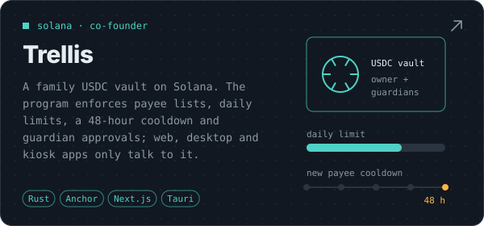
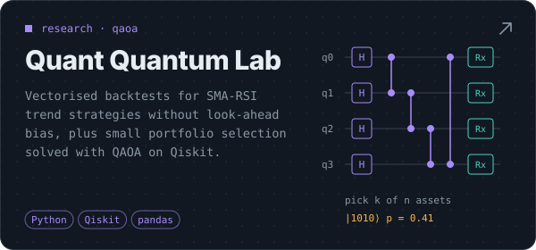
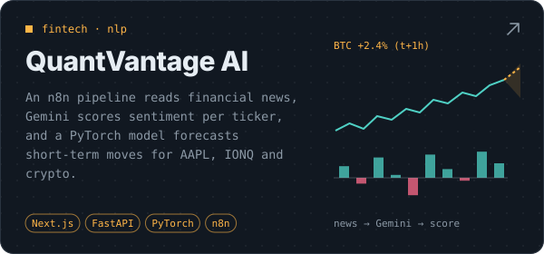
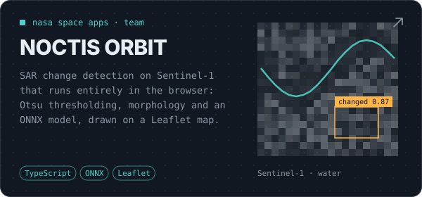
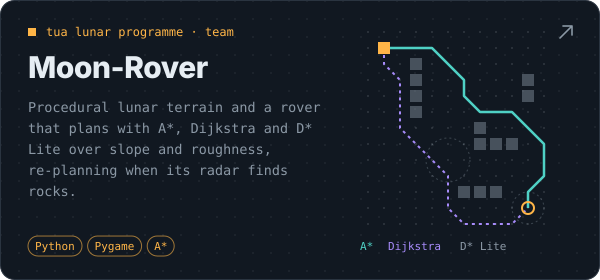
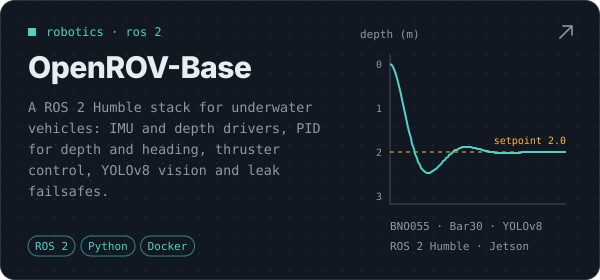
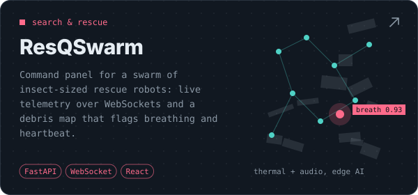
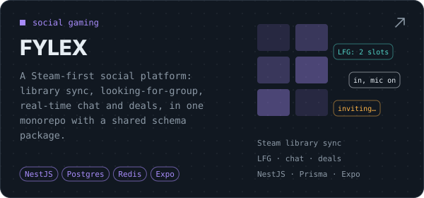

  
  
  
  

I build full-stack products end to end, from the database schema to the mobile client, and I keep drifting toward the strange edges: a Solana program that guards a family's savings, QAOA for portfolio picks, radar imagery analysed in the browser, robots that look for people under rubble. I study computer engineering at İnönü University and serve as vice president of the IEEE İnönü Student Branch.

## Projects

  
  

  
  

  
  

  
  

Also: <a href="https://github.com/fylexcon/gym_bud">GymBud</a> (Gemini fitness coach) · <a href="https://github.com/fylexcon/AskMeMore">Ask Me More</a> (couples app, Expo + Fastify) · <a href="https://github.com/fylexcon/signalpulse_ai">Feedback Hub</a> (multi-tenant B2B SaaS) · <a href="https://github.com/fylexcon/EEG-emotion-mobile-app">EEG emotion app</a> · <a href="https://github.com/fylexcon/QuantumMechanics">quantum mechanics sims</a>

## Experience

| | | |
|:--|:--|--:|
| **Co-founder** | Trellis · non-custodial family USDC vault on Solana; Next.js dashboard, Anchor program, devnet deployment | `2026–` |
| **Software developer** | Caladrius · React and TypeScript front ends for AI-driven SaaS products | `2025–` |
| **Vice president** | IEEE İnönü Student Branch · 100+ members; previously Computer Society chair, ran Python, data science and ML workshops | `2025–` |
| **Competitions** | NASA Space Apps (NOCTIS ORBIT) · Teknofest (ROS 2 perception on Jetson Orin Nano) · TUA lunar programme (Moon-Rover) | |

## Toolkit

  

also React Native · Expo · Supabase · Solana/Anchor · ROS 2 · PyTorch · TensorFlow.js · OpenCV · Qiskit · n8n

<picture>
  <source media="(prefers-color-scheme: dark)" srcset="https://raw.githubusercontent.com/fylexcon/fylexcon/output/snake-dark.svg" />
  
</picture>
